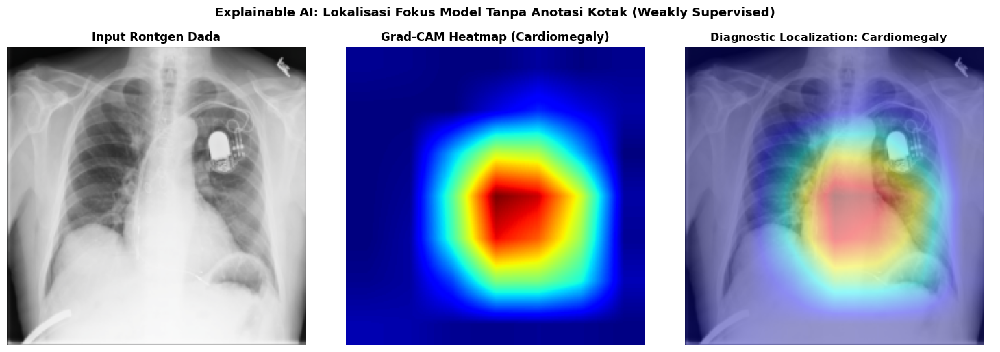
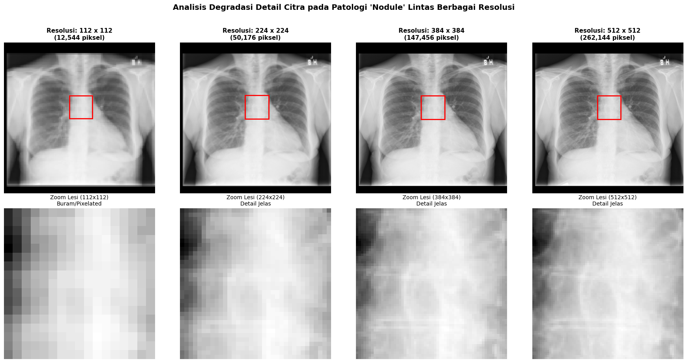

# ThoraxAI: Multi-Label Chest X-Ray Diagnostic Engine

An end-to-end Computer-Aided Diagnosis (CAD) pipeline for simultaneous multi-label detection of **14 thoracic pathologies** from frontal chest radiographs (**NIH ChestX-ray14**), built with **DenseNet-121**, **Patient-Aware Splitting**, **Weighted BCE**, **Grad-CAM Explainable AI**, and an interactive **Gradio** interface.


## Key Highlights
- **Hospital-Scale Dataset:** Trained and evaluated on **NIH ChestX-ray14** (112,120 radiographs across 30,805 unique patients, 14 multi-label pathologies).
- **Zero Patient Data Leakage:** Partitioned strictly by `Patient ID` using `GroupShuffleSplit` (89,826 training images from 24,644 patients / 22,294 validation images from 6,161 patients; **zero patient overlap**).
- **Imbalance-Aware Training:** DenseNet-121 transfer learning with per-class positive-weighted `BCEWithLogitsLoss`, AdamW (`lr=1e-4`, `weight_decay=1e-4`), Cosine Annealing LR, and FP16 Automatic Mixed Precision on an NVIDIA A100-SXM4-80GB.
- **Validation Performance:** Reached **0.8326 Mean ROC-AUC** across all 14 pathologies by Epoch 5.
- **Explainable AI (Grad-CAM):** Generates weakly-supervised class activation heatmaps from `denseblock4` without bounding-box annotations.

## Training Convergence (Validation Set: 22,294 Images)

| Epoch | Train Loss (WBCE) | Val Loss (WBCE) | Mean ROC-AUC (14 Classes) |
| :---: | :---: | :---: | :---: |
| 1 | 1.0891 | 1.0294 | 0.7947 |
| 2 | 0.9819 | 0.9918 | 0.8136 |
| 3 | 0.9100 | 0.9624 | 0.8222 |
| 4 | 0.8470 | 0.9613 | 0.8301 |
| **5** | **0.8013** | **0.9550** | **0.8326** |

## Zero-Shot Spatial Resolution Trade-Off (`Nodule`)

To study the accuracy–latency trade-off for small focal lesions (`Nodule`), the 224×224-trained model was evaluated zero-shot across four input resolutions on a 500-image validation subset:

| Input Resolution | Pixels | Nodule ROC-AUC | Inference Latency | Observation |
| :---: | :---: | :---: | :---: | :--- |
| 112×112 | 12,544 | 0.6315 | 20.26 ms/img | Fine lesion boundaries lost to downsampling |
| **224×224** | **50,176** | **0.6686** | **21.28 ms/img** | **Optimal zero-shot sweet spot (matched to training scale)** |
| 384×384 | 147,456 | 0.6370 | 24.75 ms/img | Scale mismatch without high-res fine-tuning |
| 512×512 | 262,144 | 0.6315 | 28.86 ms/img | +35% latency with degraded zero-shot AUC |

| Grad-CAM Pathology Localization | Zero-Shot Spatial Resolution Trade-Off |
| :---: | :---: |
|  |  |

### Visual Inspection: Hierarchical Feature Flow & Multi-Scale Lesion Degradation

| Hierarchical CNN Feature Flow (`conv0` → `denseblock4` → 14 Probabilities) |
| :---: |
|  |

| Multi-Scale Lesion Degradation on `Nodule` (`112×112` → `512×512`) |
| :---: |
|  |

## Repository Structure
```text
thoraxai-cxr-diagnostic/
├── assets/          # CNN filters, augmentation gallery, Grad-CAM, and resolution plots
├── docs/            # Technical research report & non-technical overview (Indonesian)
├── notebooks/       # End-to-end training, evaluation, Grad-CAM, and Gradio notebook
└── requirements.txt
```

## Engineering Notes & Known Limitations
- **CLAHE Train-Inference Skew:** Training and validation used standard ImageNet-normalized radiographs, whereas the interactive Gradio demo applies CLAHE (`clipLimit=2.0`, `tileGridSize=(8,8)`) for visual contrast inspection. Aligning CLAHE across both training and inference is planned for the next retraining iteration.
- **Validation Protocol:** Evaluation currently uses an 80/20 patient-aware train/validation split rather than a 3-way train/val/test split, and the resolution benchmark is a zero-shot evaluation on a 500-image validation subset (achieving true high-res gains requires retraining at 384×384 or 512×512).
- **Next Steps:** Export per-class ROC-AUC & PR-AUC across all 14 pathologies with failure-case analysis, modularize into `src/`, and deploy a permanent `app.py` demo on Hugging Face Spaces.

## How to Run
1. Install dependencies:
   ```bash
   pip install -r requirements.txt
   ```
2. Download the [NIH ChestX-ray14 dataset](https://www.kaggle.com/datasets/nih-chest-xrays/data) via Kaggle CLI into `./nih_dataset/`.
3. Open and run [notebooks/thoraxai_densenet121_nih_cxr14.ipynb](./notebooks/thoraxai_densenet121_nih_cxr14.ipynb).
