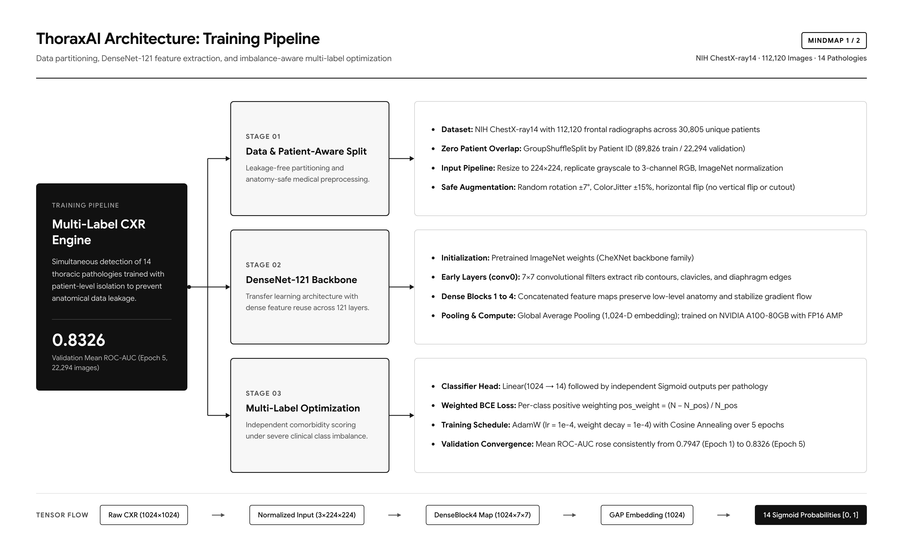
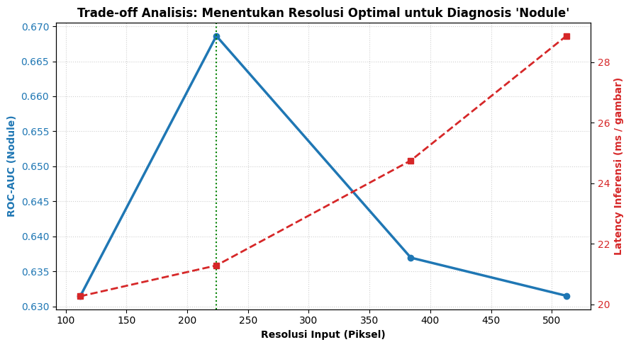
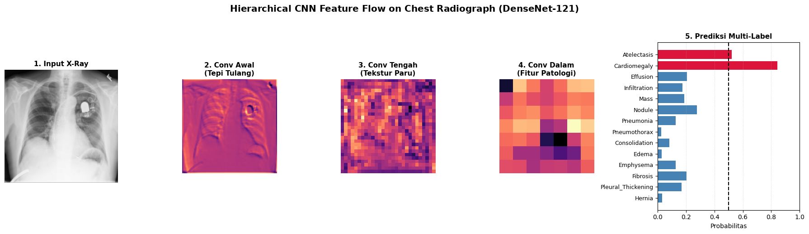

# ThoraxAI: Multi-Label Chest X-Ray Diagnostic Engine

<!-- Replace YOUR_HF_USERNAME/thoraxai-cxr-diagnostic with your deployed Hugging Face Space slug -->
[-blue?logo=huggingface)](https://huggingface.co/spaces/YOUR_HF_USERNAME/thoraxai-cxr-diagnostic)

An end-to-end Computer-Aided Diagnosis (CAD) pipeline for simultaneous multi-label detection of **14 thoracic pathologies** from frontal chest radiographs (**NIH ChestX-ray14**), built with **DenseNet-121**, **Patient-Aware Splitting**, **Weighted BCE**, **Grad-CAM Explainable AI**, and an interactive **Gradio** interface ready for Hugging Face Spaces (CPU Basic).




## Key Highlights
- **Hospital-Scale Dataset:** Trained and evaluated on **NIH ChestX-ray14** (112,120 radiographs across 30,805 unique patients, 14 multi-label pathologies).
- **Zero Patient Data Leakage:** Partitioned strictly by `Patient ID` using `GroupShuffleSplit` (89,826 training images from 24,644 patients / 22,294 validation images from 6,161 patients; **zero patient overlap**).
- **Imbalance-Aware Training:** DenseNet-121 transfer learning with per-class positive-weighted `BCEWithLogitsLoss`, AdamW (`lr=1e-4`, `weight_decay=1e-4`), Cosine Annealing LR, and FP16 Automatic Mixed Precision on an NVIDIA A100-SXM4-80GB.
- **Validation Performance:** Reached **0.8326 Mean ROC-AUC** across all 14 pathologies by Epoch 5.
- **Explainable AI (Grad-CAM):** Generates weakly-supervised class activation heatmaps from `denseblock4` without bounding-box annotations.
- **Production-Ready Inference Module:** Cleanly separated into `src/` (`config.py`, `model.py`, `gradcam.py`, `inference.py`, `evaluate_metrics.py`) with root-level `app.py` and CPU-safe checkpoint loading (`map_location="cpu"`).

## Training Convergence (Validation Set: 22,294 Images)

| Epoch | Train Loss (WBCE) | Val Loss (WBCE) | Mean ROC-AUC (14 Classes) |
| :---: | :---: | :---: | :---: |
| 1 | 1.0891 | 1.0294 | 0.7947 |
| 2 | 0.9819 | 0.9918 | 0.8136 |
| 3 | 0.9100 | 0.9624 | 0.8222 |
| 4 | 0.8470 | 0.9613 | 0.8301 |
| **5** | **0.8013** | **0.9550** | **0.8326** |

## Per-Class Validation Metrics (14 Pathologies: ROC-AUC & PR-AUC)

Run `python -m src.evaluate_metrics --dataset-dir ./nih_dataset --model-path weights/thoraxai_model.pth` against the patient-aware validation split (`22,294` images across `6,161` unique patients) to populate the table below:

| Pathology | Validation Positives | Prevalence (%) | ROC-AUC | PR-AUC |
| :--- | :---: | :---: | :---: | :---: |
| `Atelectasis` | TBD | TBD | TBD | TBD |
| `Cardiomegaly` | TBD | TBD | TBD | TBD |
| `Effusion` | TBD | TBD | TBD | TBD |
| `Infiltration` | TBD | TBD | TBD | TBD |
| `Mass` | TBD | TBD | TBD | TBD |
| `Nodule` | TBD | TBD | TBD | TBD |
| `Pneumonia` | TBD | TBD | TBD | TBD |
| `Pneumothorax` | TBD | TBD | TBD | TBD |
| `Consolidation` | TBD | TBD | TBD | TBD |
| `Edema` | TBD | TBD | TBD | TBD |
| `Emphysema` | TBD | TBD | TBD | TBD |
| `Fibrosis` | TBD | TBD | TBD | TBD |
| `Pleural_Thickening` | TBD | TBD | TBD | TBD |
| `Hernia` | TBD | TBD | TBD | TBD |
| **Macro Mean (14 Classes)** | - | - | **0.8326** *(Val Epoch 5)* | **TBD** |

## Zero-Shot Spatial Resolution Trade-Off (`Nodule`)

To study the accuracy-latency trade-off for small focal lesions (`Nodule`), the 224x224-trained model was evaluated zero-shot across four input resolutions on a 500-image validation subset:

| Input Resolution | Pixels | Nodule ROC-AUC | Inference Latency | Observation |
| :---: | :---: | :---: | :---: | :--- |
| 112x112 | 12,544 | 0.6315 | 20.26 ms/img | Fine lesion boundaries lost to downsampling |
| **224x224** | **50,176** | **0.6686** | **21.28 ms/img** | **Optimal zero-shot sweet spot (matched to training scale)** |
| 384x384 | 147,456 | 0.6370 | 24.75 ms/img | Scale mismatch without high-res fine-tuning |
| 512x512 | 262,144 | 0.6315 | 28.86 ms/img | +35% latency with degraded zero-shot AUC |

| Grad-CAM Pathology Localization | Zero-Shot Spatial Resolution Trade-Off |
| :---: | :---: |
|  |  |

### Visual Inspection: Hierarchical Feature Flow & Multi-Scale Lesion Degradation

| Hierarchical CNN Feature Flow (`conv0` -> `denseblock4` -> 14 Probabilities) |
| :---: |
|  |

| Multi-Scale Lesion Degradation on `Nodule` (`112x112` -> `512x512`) |
| :---: |
|  |

## Repository Structure
```text
thoraxai-cxr-diagnostic/
├── app.py                   # Root Gradio UI for Hugging Face Spaces (CPU Basic)
├── src/
│   ├── __init__.py
│   ├── config.py            # 14 NIH labels, ImageNet normalization, CLAHE, model paths
│   ├── model.py             # DenseNet-121 architecture & CPU-safe checkpoint loading
│   ├── gradcam.py           # Weakly-supervised Grad-CAM targeting denseblock4
│   ├── inference.py         # End-to-end predict_chest_xray() pipeline
│   └── evaluate_metrics.py  # Standalone per-class ROC-AUC & PR-AUC evaluator
├── examples/                # Sample chest radiographs for 1-click Gradio testing
├── assets/                  # CNN filters, augmentation gallery, Grad-CAM, and plots
├── docs/                    # Technical research report & non-technical overview (Indonesian)
├── notebooks/               # End-to-end A100 training & exploratory experiment notebook
└── requirements.txt         # Lean Hugging Face Spaces CPU dependencies
```

## Engineering Notes & Known Limitations
- **Training vs. Visual CLAHE Alignment:** Training and validation used standard ImageNet-normalized radiographs. In the modular `src/inference.py` and `app.py` pipeline, model logits are computed strictly on standard ImageNet-normalized radiographs (eliminating train-inference distribution skew), while optional CLAHE (`clipLimit=2.0`, `tileGridSize=(8, 8)`) is applied to the visual overlay canvas for clearer inspection.
- **Validation Protocol:** Evaluation currently uses an 80/20 patient-aware train/validation split rather than a 3-way train/val/test split, and the resolution benchmark is a zero-shot evaluation on a 500-image validation subset (achieving true high-res gains requires retraining at 384x384 or 512x512).
- **Checkpoint Placement:** Large `.pth` checkpoints are excluded from Git tracking. Place your trained `thoraxai_model.pth` at `weights/thoraxai_model.pth` (or set `THORAXAI_MODEL_PATH`) before running `app.py` or `src/evaluate_metrics.py`.

## How to Run

### 1. Launch the Gradio Diagnostic App Locally
```bash
pip install -r requirements.txt
# Place trained weights at weights/thoraxai_model.pth (or export THORAXAI_MODEL_PATH=/path/to/thoraxai_model.pth)
python app.py
```

### 2. Generate Per-Class ROC-AUC & PR-AUC Table
Download the [NIH ChestX-ray14 dataset](https://www.kaggle.com/datasets/nih-chest-xrays/data) into `./nih_dataset/`, then run:
```bash
python -m src.evaluate_metrics \
  --dataset-dir ./nih_dataset \
  --model-path weights/thoraxai_model.pth
```

### 3. Train From Scratch (Notebook)
Open and run [notebooks/thoraxai_densenet121_nih_cxr14.ipynb](./notebooks/thoraxai_densenet121_nih_cxr14.ipynb) on a CUDA GPU environment (tested on NVIDIA A100-SXM4-80GB).
